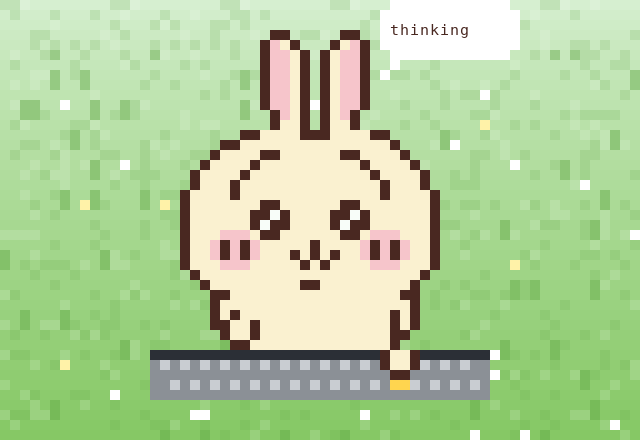
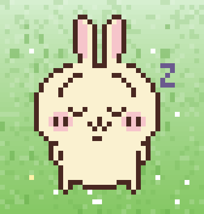
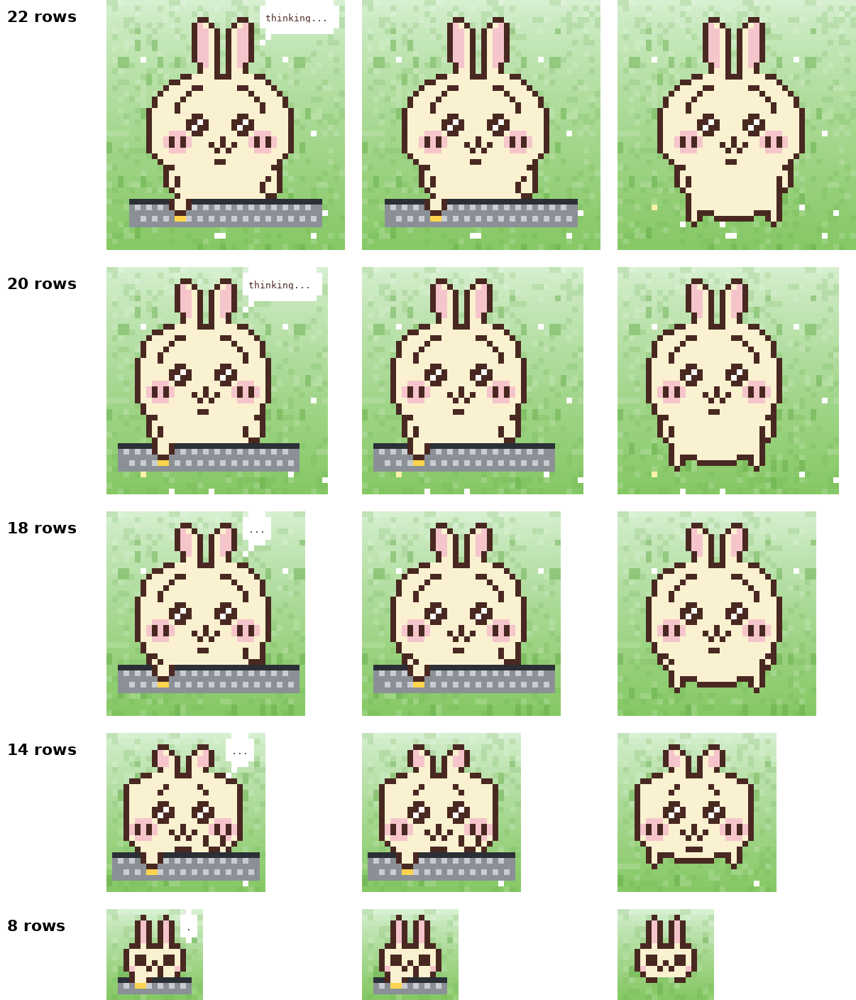

<h1 align="center">claude-mods-custom-box</h1>

<p align="center">
  <a href="https://github.com/SungsooKwon/claude-mods-custom-box"></a>
  
  
  
</p>

<p align="center">
  <sub>English · <a href="README.ko.md">한국어</a></sub>
</p>

<p align="center">
  <strong>A growing box of Claude Code mods.</strong><br/>
  Each mod does one small thing. Install only the ones you want.
</p>

## Mods

<!-- mods:start -->
| Preview | Mod | What it does |
| --- | --- | --- |
|  | [**usagi-code**](plugins/usagi-code) | Usagi acts out what Claude is doing in a pane above the prompt, with the order, subagents and progress beside it. |
<!-- mods:end -->

More mods are on the way. Each mod's features and usage are right below.

## usagi-code

A pane above the prompt where Usagi acts out what Claude is doing: typing while a tool runs, a thinking bubble between steps, standing by when it's your turn. Beside it are your order, the subagents and live progress.

```
/plugin install usagi-code@claude-mods-custom-box
```

### Features

<table>
<tr>
<td width="50%" valign="middle">

#### Stage

Types while a tool runs, shows a thinking bubble between steps, and stands by when it's your turn.

</td>
<td width="50%">
  
</td>
</tr>
<tr>
<td width="50%" valign="middle">

#### Dozing

After a quiet minute Usagi dozes off where it stands: eyes closed, breathing up and down, a snot bubble swelling and popping, `z` drifting up. It wakes as soon as Claude moves again.

</td>
<td width="50%">
  
</td>
</tr>
</table>

- **Timeline** — the order tree for this turn, the live step with its tool chain, and a progress line (steps, done, failed).
- **Subagents** — each spawned agent with its type, task, state and the tool it is using now.
- **Heads-up popups** — a permission prompt or a question pops a dialog (“Usagi: hey! i need ur OK …”); a failed tool shows its first error line.
- **Usage warnings** — context %, 5-hour and weekly limits in the status bar, with a nudge toward `/compact` and the reset time when you get close.
- **2010s skins** — Windows 7, Mac OS X and Ubuntu themes, picked from your OS or set by hand.
- **Resizable stage** — ▲ ▼ in the status bar, or `/usagi +` / `/usagi -`; the size is kept across sessions. 22, 20, 18, 14 and 8 rows each have hand-drawn art. At 18 rows and below Usagi stands centred and the thinking bubble shows only dots (. .. ...).

> The pane's labels are in Korean for now.

### Usage

| Command | What it does |
| --- | --- |
| `/usagi` | Open or close the pane |
| `/usagi +` · `/usagi -` · `/usagi size <n>` | Resize Usagi (rows) |
| `/usagi theme <windows7 \| macos \| ubuntu>` | Switch the look for this session |

> **Usagi looks most natural at 22, 20, 18, 14 and 8 rows.** Those sizes use hand-drawn art as is; other sizes scale the 22-row art and can drop pixels, so the eyes may look off. `/usagi size 22` brings back the default.
>
> Here is how the resolution differs by size (left to right: thinking, typing, standing). Use it as a reference when picking a size.

<p align="center">
  
</p>

**Where the pane sits is up to Claude Code.** In the fullscreen layout (the default) a terminal 110 columns or wider docks it to the right of the conversation (Usagi asks for a 46-column dock so the stage fits); narrower, it sits above the prompt. To keep it above the prompt, start with `CLAUDE_CODE_NO_FLICKER=0 claude` or run inside tmux.

Lasting settings (open on startup, theme) live in `/plugin configure usagi-code`. Terminal only.

### Credits

Ported from [clockendbader/mascot-studio](https://github.com/clockendbader/mascot-studio) (MIT). The original author's notice is kept in [LICENSE](plugins/usagi-code/LICENSE).

## Install

Add the marketplace once, then install any mod in it by name. At the prompt of a Claude Code terminal session:

```
/plugin marketplace add SungsooKwon/claude-mods-custom-box
/plugin install <mod>@claude-mods-custom-box
```

To pick up newly added mods, refresh the list:

```
/plugin marketplace update claude-mods-custom-box
```

_In one line:_ `/plugin install <mod> --marketplace SungsooKwon/claude-mods-custom-box` (answer `y` to add the marketplace, then Enter for the user scope).

_From a shell:_ replace the leading `/` with `claude ` (e.g. `claude plugin install <mod>@claude-mods-custom-box`).

_In the desktop app_ (where `/plugin` does not run): click **+** next to the prompt box → **Plugins** → **Add marketplace** with `SungsooKwon/claude-mods-custom-box` → **Add plugin**.

## Making a mod

```
plugins/<mod>/                    one mod (plugin.json, hooks/, tests/, README.md, assets/)
.claude-plugin/marketplace.json   the list of installable mods
scripts/new-mod.sh                scaffold a mod and list it in the marketplace and README tables
scripts/check.sh                  check list, README and folders agree, then validate and test
```

```bash
scripts/new-mod.sh <mod-name> "One-line description" "한 줄 설명"
claude --plugin-dir plugins/<mod-name>      # run Claude Code with it loaded
scripts/check.sh [mod-name ...]             # all mods when no name
```

Before you push: fill in the mod's `README.md` and add the same as a `## <mod>` section under Mods here, put a preview at `plugins/<mod>/assets/preview.gif` and swap the `—` in the README tables for it, and make sure `scripts/check.sh` passes. `new-mod.sh` needs `jq`.

## Community &amp; Support

- **Feedback &amp; ideas:** [Open an issue](https://github.com/SungsooKwon/claude-mods-custom-box/issues) — bugs, requests, or a mod you'd like to see.
- **Show support:** [Star](https://github.com/SungsooKwon/claude-mods-custom-box) this repo to follow new mods.

## License

[MIT License](LICENSE). A mod ported from another project keeps the original author's notice in its own folder's `LICENSE`.
