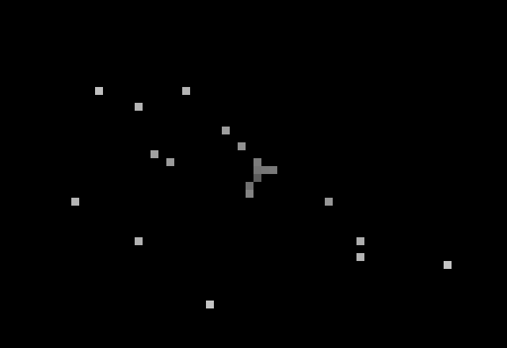

<h1 align="center">Usagi code</h1>

<p align="center">
  
</p>

<p align="center">
  <sub><a href="README.md">English</a> · 한국어</sub>
</p>

프롬프트 위 pane 에서 Usagi 가 Claude 가 하는 일을 연기합니다. 도구가 도는 동안 키보드를 치고, 단계 사이엔 생각 말풍선을 띄우고, 사용자 차례면 가만히 기다립니다. 옆에는 지시 순서, 서브에이전트, 진행 상황이 실시간으로 나옵니다.

```
/plugin install usagi-code@claude-mods-custom-box
```

marketplace 를 아직 추가하지 않았다면 [저장소 README 의 설치](../../README.ko.md) 를 먼저 보세요.

## 기능

<table>
<tr>
<td width="50%" valign="middle">

### 무대

도구가 돌면 키보드를 치고, 단계 사이엔 생각 말풍선, 차례가 넘어오면 가만히 서서 기다립니다.

</td>
<td width="50%">
  
</td>
</tr>
<tr>
<td width="50%" valign="middle">

### 화면보호기

자리를 비우면 무대가 90년대 화면보호기로 바뀝니다. 자라는 파이프, 별 사이 비행, 날아다니는 작은 마스코트가 나오고, Claude 가 다시 움직이면 돌아옵니다.

</td>
<td width="50%">
  
</td>
</tr>
</table>

- **타임라인** — 이번 지시의 순서 트리, 지금 단계와 도구 사슬, 진행 줄(단계 수·완료·실패).
- **서브에이전트** — 띄운 에이전트마다 종류, 맡은 일, 상태, 지금 쓰는 도구.
- **알림 팝업** — 권한 요청이나 질문이 오면 대화창(“Usagi: hey! i need ur OK …”)이 뜨고, 도구가 실패하면 첫 오류 줄을 보여 줍니다.
- **사용량 경고** — 상태 표시줄에 컨텍스트 %, 5시간·주간 한도. 한도에 가까워지면 `/compact` 권유와 리셋 시각을 띄웁니다.
- **2010년대 스킨** — Windows 7, Mac OS X, Ubuntu 테마. OS 에 맞춰 고르거나 직접 지정합니다.
- **무대 크기 조절** — 상태 표시줄의 ▲ ▼ 또는 `/usagi +` / `/usagi -`. 크기는 세션이 바뀌어도 유지됩니다. 22·20·18·14·8줄은 크기마다 손으로 그린 도안입니다. 18줄 이하는 토끼를 가운데 두고, 생각 말풍선은 점(. .. ...)만 보여 줍니다.

> pane 안의 문구는 현재 한국어입니다.

## 사용법

| 명령 | 동작 |
| --- | --- |
| `/usagi` | pane 열기 / 닫기 |
| `/usagi +` · `/usagi -` · `/usagi size <n>` | Usagi 크기(줄 수) 조절 |
| `/usagi theme <windows7 \| macos \| ubuntu>` | 이번 세션의 테마 변경 |

> **22·20·18·14·8줄이 가장 자연스럽습니다.** 이 다섯 크기는 손으로 그린 도안을 그대로 쓰고, 다른 크기는 22줄 그림을 줄이거나 늘려서 픽셀이 빠지면 눈 모양이 어색해질 수 있습니다. `/usagi size 22` 로 기본 크기에 돌아옵니다.
>
> 크기별 해상도 차이는 아래 그림과 같습니다(왼쪽부터 생각 중, 키보드 치는 중, 서 있음). 크기를 고를 때 참고하세요.

<p align="center">
  
</p>

**pane 위치는 Claude Code 가 정합니다.** 전체 화면 모드(기본)에서 터미널이 110열 이상이면 대화 오른쪽에 붙고(이때 무대가 다 들어가는 46열 폭을 청합니다), 그보다 좁으면 프롬프트 위에 들어갑니다. 늘 프롬프트 위에 두려면 `CLAUDE_CODE_NO_FLICKER=0 claude` 로 실행하거나 tmux 안에서 실행하세요.

계속 쓸 설정(시작할 때 열기, 화면보호기 분, 테마)은 `/plugin configure usagi-code` 에서 바꿉니다. 터미널 전용입니다.

## 출처

[clockendbader/mascot-studio](https://github.com/clockendbader/mascot-studio) (MIT) 를 옮겨 고쳤습니다. 원작자 저작권 표기는 [LICENSE](LICENSE) 에 함께 있습니다.
