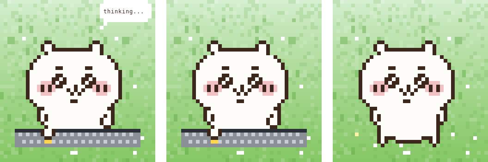
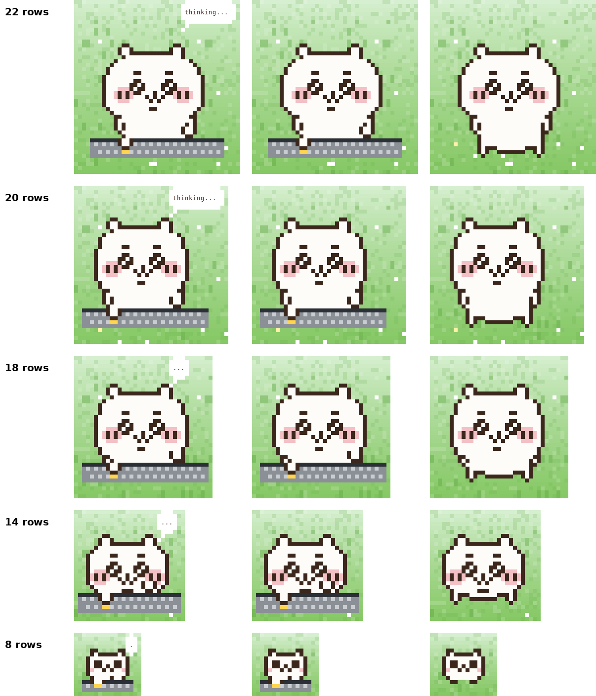

<h1 align="center">Usagi code</h1>

<p align="center">
  
</p>

<p align="center">
  <sub>English · <a href="README.ko.md">한국어</a></sub>
</p>

A pane above the prompt where Usagi or Chiikawa acts out what Claude is doing: typing while a tool runs, a thinking bubble between steps, standing by when it's your turn. Beside it are your order, the subagents and live progress.

```
/plugin install usagi-code@claude-mods-custom-box
```

Haven't added the marketplace yet? See [Install in the repository README](../../README.md) first.

## Features

<table>
<tr>
<td width="50%" valign="middle">

### Stage

Types while a tool runs, shows a thinking bubble between steps, and stands by when it's your turn.

</td>
<td width="50%">
  
</td>
</tr>
<tr>
<td width="50%" valign="middle">

### Dozing

After a quiet minute Usagi dozes off where it stands: eyes closed, breathing up and down, a snot bubble swelling and popping, `z` drifting up. It wakes as soon as Claude moves again.

</td>
<td width="50%">
  
</td>
</tr>
<tr>
<td width="50%" valign="middle">

### Characters

Pick who stands on the stage: Usagi or Chiikawa. `/chiikawa` brings Chiikawa on for this session and `/usagi` brings Usagi back; Character in `/plugin configure usagi-code` keeps one. Both do everything above, dozing included, with hand-drawn art at every size.

</td>
<td width="50%">
  
</td>
</tr>
</table>

- **Timeline** — the order tree for this turn, the live step with its tool chain, and a progress line (steps, done, failed).
- **Subagents** — each spawned agent with its type, task, state and the tool it is using now.
- **Heads-up popups** — a permission prompt or a question pops a dialog (“Usagi: hey! i need ur OK …”, in the voice of whoever is on stage); a failed tool shows its first error line.
- **Usage warnings** — context %, 5-hour and weekly limits in the status bar, with a nudge toward `/compact` and the reset time when you get close.
- **2010s skins** — Windows 7, Mac OS X and Ubuntu themes, picked from your OS or set by hand.
- **Resizable stage** — ▲ ▼ in the status bar, or `/usagi +` / `/usagi -` (`/chiikawa +` / `/chiikawa -` for Chiikawa); the size is kept across sessions. 22, 20, 18, 14 and 8 rows each have hand-drawn art for both characters. At 18 rows and below the character stands centred and the thinking bubble shows only dots (. .. ...).

> The pane's labels are in Korean for now.

## Usage

| Command | What it does |
| --- | --- |
| `/usagi` · `/chiikawa` | Open or close the pane with that character on stage; if the other one is showing, swap in this one (this session) |
| `/usagi +` · `/usagi -` · `/usagi size <n>` | Resize the stage (rows); `/chiikawa +` · `/chiikawa -` · `/chiikawa size <n>` do the same with Chiikawa on stage |
| `/usagi theme <windows7 \| macos \| ubuntu>` | Switch the look for this session |

> **Both characters look most natural at 22, 20, 18, 14 and 8 rows.** Those sizes use hand-drawn art as is; other sizes scale the 22-row art and can drop pixels, so the eyes may look off. `/usagi size 22` brings back the default.
>
> Here is how the resolution differs by size (left to right: thinking, typing, standing), Usagi first, then Chiikawa. Use it as a reference when picking a size.

<p align="center">
  
</p>

<p align="center">
  
</p>

**Where the pane sits is up to Claude Code.** In the fullscreen layout (the default) a terminal 110 columns or wider docks it to the right of the conversation (Usagi asks for a 46-column dock so the stage fits); narrower, it sits above the prompt. To keep it above the prompt, start with `CLAUDE_CODE_NO_FLICKER=0 claude` or run inside tmux.

Lasting settings (open on startup, theme, character) live in `/plugin configure usagi-code`. Terminal only.

## Credits

Ported from [clockendbader/mascot-studio](https://github.com/clockendbader/mascot-studio) (MIT). Usagi and Chiikawa are characters from Nagano's *Chiikawa*; the pixel art here is fan-made. The original author's notice is kept in [LICENSE](LICENSE).
